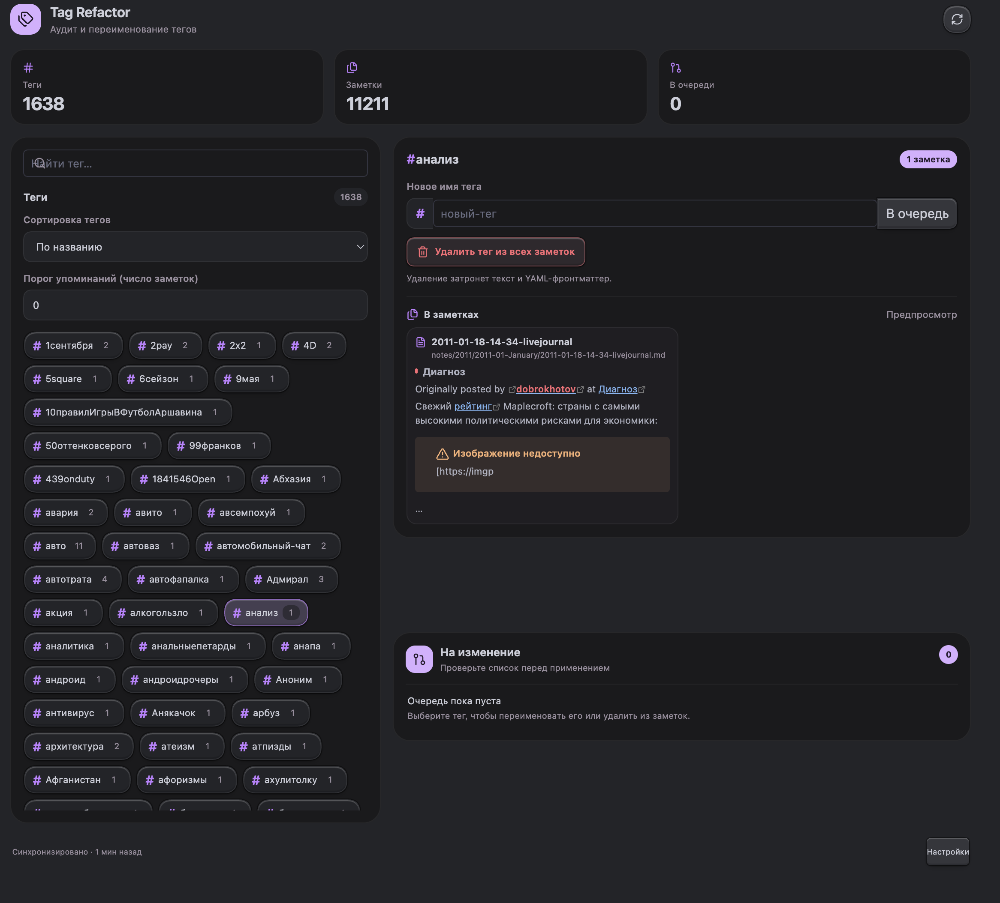

# Tag Refactor & Auditor — установка без npm

## Открытие в основном окне

Плагин открывается в центральной области Obsidian как отдельная вкладка, а не в узкой правой/левой панели. Используются `workspace.getLeaf("tab")` и `workspace.iterateRootLeaves()`. Если прежняя версия уже открыла плагин в боковой панели, при первом открытии старая вкладка будет закрыта и создана новая в основной области.

## Установка

1. Откройте папку хранилища Obsidian и перейдите в `.obsidian/plugins/`.
2. Распакуйте папку `tag-refactor-auditor` из архива в `plugins`.
3. Убедитесь, что в `.obsidian/plugins/tag-refactor-auditor/` лежат `main.js`, `manifest.json` и `styles.css`.
4. Перезапустите Obsidian либо отключите и включите плагин в настройках **Сторонние плагины**.

Плагин устанавливается из готового `main.js`: npm, Node.js и сборщик на компьютере пользователя не нужны. `source-modules/` содержит декомпозированные исходники для чтения и дальнейшей разработки; Obsidian их не загружает.

## Модули исходного кода

- `main.js` — точка входа, очередь изменений, применение и отмена пакета.
- `scanner.js` — индексирование тегов в хранилище.
- `tag-utils.js` — обработка тегов, YAML и текстовых упоминаний.
- `view.js` — UI основной вкладки, бенто-раскладка, сортировка тегов и карточки предпросмотра.
- `modals.js` — подтверждение операции и отчёт.
- `settings.js` — вкладка настроек.
- `utils.js` — общие UI- и форматирующие функции.
- `constants.js` — настройки по умолчанию и ID вкладки.

`main.js` собран в один файл, поскольку загрузчик плагинов Obsidian ожидает bundled entry point и не загружает соседние файлы по обычным относительным `require()`-путям. Версия `1.0.2`: компактная бенто-верстка с ограниченной шириной, сортировкой тегов (название, последнее упоминание, количество) и открытием заметки из карточки предпросмотра в новой вкладке.
